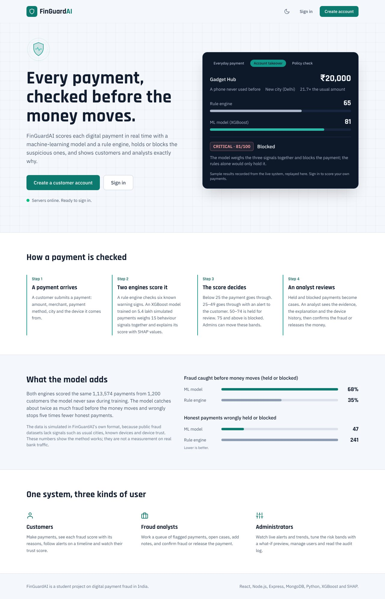
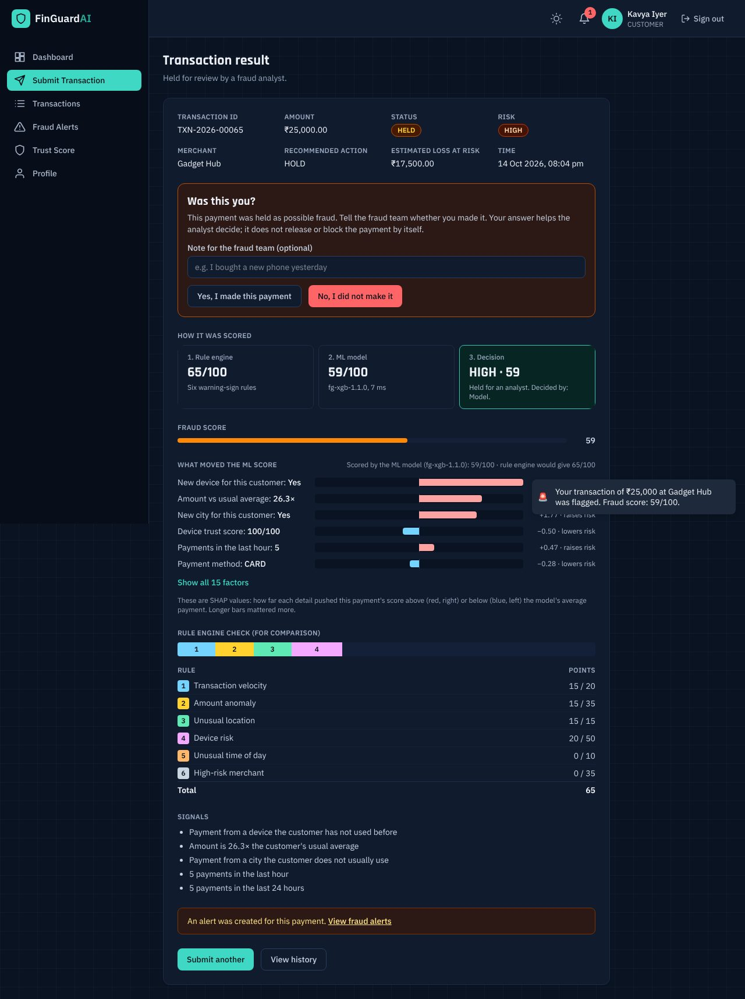
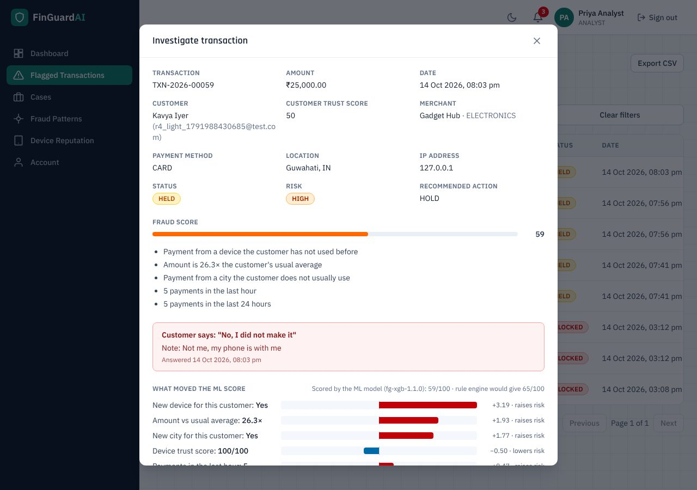
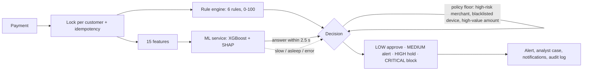

# FinGuardAI: Intelligent Fraud Detection System

FinGuardAI checks every digital payment before the money moves. A machine-learning model (XGBoost) and a rule engine score each payment in real time. The system then approves it, raises an alert, holds it for an analyst or blocks it, and it shows customers and analysts exactly why.

It is a student project on digital payment fraud in India, built with React, Node.js / Express, MongoDB and a separate Python ML service.

| | |
|---|---|
| **Live app** | https://fin-guard-ai-woad.vercel.app |
| **API** (Render) | https://finguardai-ql8z.onrender.com/health |
| **ML service** (Render) | https://finguardai-ml.onrender.com/health |

> The API and the ML service run on Render's free tier, which sleeps after 15 minutes without traffic. Opening the home page wakes them in the background; the first visit after a quiet spell can take about a minute.



---

## What it does

**Customers**
- Make a payment and see its fraud score, with the reasons and how it was scored: rule engine → ML model → decision.
- See which details pushed the model's score up or down (SHAP values).
- Answer **"Was this you?"** on a held or blocked payment. The answer goes to the fraud team as evidence.
- Follow their alerts on a timeline and watch their trust score.

**Fraud analysts**
- Work a queue of flagged payments and open cases.
- Add notes, then confirm the fraud or release the payment.
- See each customer's answer, the device history and fraud patterns.

**Administrators**
- Watch live alerts, trends and a 7-day forecast.
- Tune the risk bands with a what-if preview.
- Manage users, read the audit log, generate demo data and see which engine is scoring payments.
- Check the model in real use on **Model insights**: how often it agrees with the rule engine, the biggest disagreements, what it leans on, and how analysts' decisions turned out.

**Everyone** gets a light theme and a dark "night watch" theme. The app follows the device setting until you pick one. The **model card** (`/model`, no sign-in needed) explains what the model was trained on, how well it works, what it looks at and where its limits are.

| Result of a held payment (dark theme) | Analyst view with the customer's answer |
|---|---|
|  |  |

## How a payment is scored



- **The model decides when it answers.** If it is slow, asleep or wrong in any way, the rule engine's score is used and the reason is stored. A payment is never refused because of the ML service.
- **Policy floor.** A merchant on the admin's high-risk list, a blacklisted device or an amount above the high-value limit is at least MEDIUM when the rules rate it so. The floor only ever adds an alert: only the model can hold or block a payment.
- **Same bands for both engines.** Both engines use the admin's risk bands, so the Thresholds page works for both.

Details: [`docs/ARCHITECTURE.md`](docs/ARCHITECTURE.md) and [`docs/PHASE_10_ML_INTEGRATION.md`](docs/PHASE_10_ML_INTEGRATION.md).

## Results of the model

Both engines were measured on 1,13,574 simulated payments from 1,200 customers the model never saw.

| | ML model | Rule engine |
|---|---|---|
| ROC-AUC | **0.933** | 0.843 |
| Fraud caught before money moves (HIGH or above) | **68 %** | 35 % |
| Honest payments wrongly held or blocked | **47** | 241 |

The data is simulated in FinGuardAI's own format, because public fraud datasets lack signals such as usual cities, known devices and device trust. These numbers show the method works; they are not a measurement on real bank traffic. Limitations are listed in [`ml-service/README.md`](ml-service/README.md) and on the app's public model card ([`/model`](https://fin-guard-ai-woad.vercel.app/model)).

## Repository layout

```
backend/      Express 5 API, MongoDB (Mongoose 9), Socket.io, rule engine, ML client      → Render
frontend/     React 19 + Vite 8 + Tailwind 4 + Redux Toolkit                             → Vercel
ml-service/   Flask + XGBoost + TreeSHAP, synthetic data generator, training, evaluation → Render
docs/         Architecture, Phase 10 (ML) notes, audits, screenshots
FIX_LOG.md    What each review round fixed
.github/      CI workflow (tests for all three parts on every push)
```

## Run it locally

You need Node.js 24, Python 3.13 and a MongoDB database (MongoDB Atlas free tier works).

Commands are for Windows PowerShell; on macOS / Linux use `cp` and `source .venv/bin/activate`.

```powershell
# 1. Backend (http://localhost:5000)
cd backend
Copy-Item .env.example .env   # then fill in MONGODB_URI, JWT_SECRET, ADMIN_EMAIL / ADMIN_PASSWORD …
npm ci
npm run seed:admin            # creates the admin account and the default thresholds
npm run dev

# 2. Frontend (http://localhost:3000), in a second terminal
cd frontend
npm ci
npm run dev                   # forwards /api to the backend

# 3. ML service (optional, http://localhost:5001), in a third terminal
cd ml-service
py -3.13 -m venv .venv
.venv\Scripts\Activate.ps1
pip install -r requirements.txt
$env:ML_API_KEY = python -c "import secrets; print(secrets.token_hex(32))"
python wsgi.py
```

To let the model score payments locally, put `ML_ENABLED=true`, `ML_SERVICE_URL=http://localhost:5001` and the same `ML_API_KEY` in `backend/.env`. Without them, the rule engine scores every payment.

Every variable is explained in `backend/.env.example`, `frontend/.env.example` and `ml-service/.env.example`.

### Demo data and demo accounts

```bash
cd backend
# PowerShell: $env:API_URL="https://<your-api>"; $env:ANALYST_INVITE_CODE="<code>"; npm run seed:demo
API_URL=https://<your-api> ANALYST_INVITE_CODE=<code> npm run seed:demo
```

This creates 5 demo customers and 2 demo analysts (`demo.aarav@example.com`, `demo.priya@example.com`, …; password `Demo@12345` unless `DEMO_PASSWORD` is set), with payments at every risk level and a few cases.

To show one-click "Try as a customer / analyst" buttons on the login page, set `VITE_DEMO_LOGINS=true` on Vercel and redeploy. There is deliberately no demo **admin** button. Anyone who opens the site can use these accounts, so keep them demo-only.

## Tests

| Part | Command | Tests |
|---|---|---|
| Backend | `cd backend && npm test` (set `MONGO_URI_TEST` to a separate database such as `…/finguardai_test`) | 577 |
| Frontend | `cd frontend && npm test` | 605 (+ coverage gates with `npm run test:coverage`) |
| ML service | `cd ml-service && pip install -r requirements-train.txt && python -m pytest -q` | 106 |

Lint: `npm run lint` in `backend` and `frontend`, `ruff check .` in `ml-service`.

**Continuous integration.** [`.github/workflows/ci.yml`](.github/workflows/ci.yml) runs all of the above on GitHub Actions for every push and pull request: three parallel jobs, a throw-away MongoDB 8 container for the backend, and no secrets. Results are on the repository's *Actions* tab.

## Deployment

| Service | Platform | Settings |
|---|---|---|
| Frontend | Vercel | Root `frontend`; `VITE_API_URL=https://<api>.onrender.com` |
| API | Render (web service) | Root `backend`; start `npm start`; variables from `backend/.env.example` (production: `NODE_ENV=production`) |
| ML service | Render (web service) | Root `ml-service`; build `pip install -r requirements.txt`; start `gunicorn -c gunicorn.conf.py wsgi:app`; `ML_API_KEY`, `PYTHON_VERSION=3.13.16` |

After a release that adds indexes, run `npm run db:sync-indexes` once against the production database.

## Troubleshooting

- **`querySrv ECONNREFUSED` from Atlas on Windows.** Some networks block DNS SRV lookups. Use Atlas's standard (non-`+srv`) connection string, or switch the network's DNS server to 8.8.8.8.
- **Backend tests fail with "MD5 check failed" or hang while downloading MongoDB.** The built-in test database download failed. Set `MONGO_URI_TEST` in the same terminal to a disposable Atlas database (it must not be the production one: the tests wipe it).
- **The first payment after a quiet period was scored by the rule engine.** The ML service was asleep. Opening *Submit transaction* or the admin dashboard wakes it; the admin dashboard shows its state.
- **The admin card says "ML key rejected".** `ML_API_KEY` must be identical on the API and the ML service.

## Documentation

- [`docs/ARCHITECTURE.md`](docs/ARCHITECTURE.md): models, request flow, every route.
- [`docs/PHASE_10_ML_INTEGRATION.md`](docs/PHASE_10_ML_INTEGRATION.md): ML decisions, results, verification.
- [`ml-service/README.md`](ml-service/README.md): feature contract, training, evaluation, limitations.
- [`FIX_LOG.md`](FIX_LOG.md) and [`docs/audit/`](docs/audit): review rounds.
