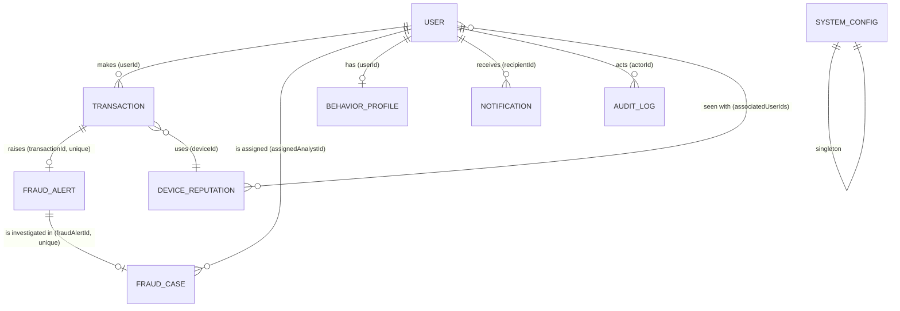

# FinGuardAI: Architecture, API and demo script

## Data model (MongoDB, Mongoose)



| Collection | Purpose | Notes |
|---|---|---|
| User | Account, role (CUSTOMER / ANALYST / ADMIN), trust score | `password` is `select:false` and stripped by `toJSON`; `sessionsRevokedAt` ends sessions on deactivation; `isSimulated` marks demo users |
| Transaction | One payment with its fraud score, reasons and per-rule `scoreBreakdown` | Public id `TXN-YYYY-NNNNN`; status APPROVED / HELD / BLOCKED; optional `idempotencyKey` (hidden); Phase 10 `scoring` = engine (ML / RULES), rule score, model version, SHAP values, fallback reason |
| FraudAlert | Raised for MEDIUM, HIGH, CRITICAL | One per transaction (unique); status OPEN / REVIEWED / DISMISSED / ACKNOWLEDGED; Phase 10 `scoringEngine`, `modelVersion` |
| FraudCase | Analyst investigation | Public id `CASE-YYYY-NNNNN`; OPEN → ASSIGNED → UNDER_REVIEW → RESOLVED (fraud confirmed) or DISMISSED (false positive) |
| BehaviorProfile | Learned usual amounts, cities, hours, devices of a customer | Built from the newest 500 trusted transactions |
| DeviceReputation | Score and flags per device id | Shared across users; created only while a user is below `MAX_DEVICES_PER_USER` |
| Notification | In-app messages (live over Socket.io) | TTL `NOTIFICATION_TTL_DAYS` (default 90) |
| AuditLog | Who did what | Append-only (update/delete hooks reject changes); optional TTL via `AUDIT_LOG_TTL_DAYS` |
| SystemConfig | Thresholds, velocity limits, high-risk merchants | Singleton; compare-and-set updates |

## Request flow for a payment

`POST /customer-api/transactions` → validators → per-user lock → `services/transactionService.processTransaction`: idempotency replay check → load profile, device reputation and live velocity counts → `services/scoringService.scoreTransaction`: `checkFraud` (pure rule engine) always runs; when `ML_ENABLED=true` the 15 features are sent to the Python ML service (`ml-service/`, XGBoost + SHAP) and its score decides, with the same bands and actions (alert-only rule floor: a high-risk merchant, blacklisted device or high-value amount keeps the payment at least MEDIUM) — on a timeout or any error the rule result is used and the reason stored → create transaction with sequential id → alert (HIGH/CRITICAL/MEDIUM) → device reputation, trust score, behaviour profile → audit + notifications + Socket.io events. The admin demo-data generator calls the same service.

## API summary (all JSON, cookie auth; `/health` is public)

| Area | Method and path | Role |
|---|---|---|
| Auth | `POST /auth/register`, `POST /auth/login`, `POST /auth/logout`, `GET /auth/check-auth`, `PATCH /auth/change-password` | public / any |
| Customer | `POST /customer-api/transactions` (optional `Idempotency-Key`), `GET /customer-api/transactions`, `GET /customer-api/transactions/:id` | CUSTOMER |
| | `GET /customer-api/fraud-alerts`, `GET /customer-api/fraud-alerts/:id`, `PATCH /customer-api/fraud-alerts/:id/acknowledge` (MEDIUM only) | CUSTOMER |
| | `GET /customer-api/timeline`, `GET /customer-api/trust-score`, `GET/PATCH /customer-api/profile` | CUSTOMER |
| | `POST /customer-api/ml-warm-up` (wakes a sleeping ML service; 202 at once) | CUSTOMER |
| Notifications | `GET /notification-api/notifications`, `PATCH .../read-all`, `GET .../unread-count`, `PATCH .../:id/read` | CUSTOMER, ANALYST |
| Analyst | `GET /analyst-api/flagged-transactions`, `GET .../flagged-transactions/:id` (HIGH/CRITICAL only) | ANALYST |
| | `POST /analyst-api/cases`, `GET /analyst-api/cases`, `GET .../cases/:id`, `PATCH .../cases/:id/assign`, `PATCH .../cases/:id/status`, `POST .../cases/:id/notes` | ANALYST |
| | `GET /analyst-api/devices/:deviceId`, `GET /analyst-api/fraud-patterns` | ANALYST |
| Admin | `GET /admin-api/users`, `PATCH /admin-api/users/:id/status` | ADMIN |
| | `GET /admin-api/analytics`, `GET /admin-api/analytics/trends` (with 7-day forecast) | ADMIN |
| | `GET/PATCH /admin-api/thresholds`, `POST /admin-api/thresholds/preview` | ADMIN |
| | `POST /admin-api/simulation/start`, `.../stop`, `.../generate`, `DELETE .../simulation/data` | ADMIN |
| | `GET /admin-api/audit-logs` | ADMIN |
| | `GET /admin-api/ml-status` (Phase 10: engine state + last-24-hour counts; also wakes an idle ML service) | ADMIN |

Errors use `{ success:false, message, errors? }`. Validation errors are HTTP 422; a dead (deactivated) session is 401 with `code:'ACCOUNT_DEACTIVATED'`.

## Three-minute demo script
1. **Admin** logs in (seeded account) → Dashboard: *Fraud scoring engine* card (ML model or rule engine) → Simulation → *Generate demo transactions* (30) → Dashboard: KPIs, risk distribution, score histogram, top devices, high-risk by city and payment method; set a date range.
2. **Customer** (`npm run seed:demo` accounts or register) → Submit a normal payment (approved, score 0) then a risky one (new city, large amount, new device) → see the score explanation (with ML on: *What moved the ML score* SHAP bars plus the rule engine's view for comparison), the HELD/BLOCKED status, then *Fraud alerts → Timeline*. Acknowledge a MEDIUM alert.
3. **Analyst** → Flagged transactions → Investigate (device reputation, breakdown) → Open case → Assign to me → Start review → Resolve (fraud confirmed: payment becomes BLOCKED) or Dismiss (released). Export CSV.
4. **Admin** → Trends (forecast), Thresholds → *Preview impact*, Audit logs, User management (deactivate a user: their open tab is signed out with a clear message) → Simulation → *Clear demo data*.

## ML scoring service (Phase 10)

```
Customer pays ─► backend (transactionService) ─► scoringService
                                                   ├─ checkFraud (rules, always)        ─┐
                                                   └─ POST ml-service /predict ──────────┤ ML answer within ML_TIMEOUT_MS?
                                                        (X-API-Key, 15 features)          │   yes → ML score decides
                                                                                          │   no  → rule score decides
                                                   rule floor (policy signal → ≥ MEDIUM, < HIGH)          │
                                                   decisionForScore (admin bands) ◄──────┘
```

* `ml-service/` is a separate Flask app (its own README): synthetic training data in FinGuardAI's schema,
  an XGBoost model, and TreeSHAP explanations. Deployed as a second Render free web service.
* Backend files: `config/mlSettings.js` (env), `services/mlFeatureBuilder.js` (features, same conditions as the
  rules), `services/mlClient.js` (HTTP, timeout, cool-down, wake-up, response validation),
  `services/scoringService.js` (engine choice, alert-only rule floor).
* The ML service sleeps 15 minutes after the last payment (Render free). Opening *Submit transaction* or the admin
  dashboard wakes it in the background (never on a timer); during a cold start payments go straight to the rules.
* Frontend: `FraudExplanation` shows the SHAP bars (`MlExplanation`) for ML-scored payments and the rule
  breakdown as a comparison; `MlStatusCard` on the admin dashboard.
* Off by default: without `ML_ENABLED=true` every payment is scored by the rules exactly as before.
